# TTM: A Structural Model of Time

**A Paradigm-Expanding Framework Compatible with Special Relativity, General Relativity, and Quantum Mechanics**

- **Author:** Stewart Zambrano (Independent Researcher)
- **Location:** Bolívar, Venezuela
- **Date:** July 16, 2026
- **Correspondence:** theoryfrcl@gmail.com
- **Repository PDF:** [MTI_Parte_1.pdf](https://raw.githubusercontent.com/Stewart-Zambrano/ttm-structural-model-of-time/main/MTI_Parte_1.pdf)
- **Academic Profiles:** [PhilPeople](https://philpeople.org/profiles/stewart-zambrano) | [LinkedIn](https://www.linkedin.com/in/stewart-zambrano)

---

## Abstract

The nature of time remains one of the most profound open questions in both physics and philosophy. While special relativity, general relativity, and quantum mechanics each provide partial descriptions of temporal phenomena, a unified structural explanation of the fundamental nature of time remains elusive. In this work, we propose a model of time that is embedded within a timeless n-n-dimensional hypervolume that is, n dimensions of space and n dimensions of field-focusing only on the structure of the 4th and 5th spatial dimensions in this first part of the research. The model presented here is fully compatible with the established predictions of special and general relativity, as well as quantum mechanics, offering an expanded conceptual perspective on their structure within an n-dimensional spatial universe. We demonstrate that the temporal-timeless matrix (temporal-timeless hypervolume) is an approach that should be considered and evaluated in greater detail, and even refined.

**Keywords:** philosophy of time, structure of time, temporal ontology, special relativity, general relativity, quantum mechanics, philosophy of physics

---

## Contents

1. [Introduction](#1-introduction)
2. [Theoretical Background](#2-theoretical-background)
   - [2.1 Time in Special Relativity](#21-time-in-special-relativity)
   - [2.2 Time in General Relativity](#22-time-in-general-relativity)
   - [2.3 Time in Quantum Mechanics](#23-time-in-quantum-mechanics)
   - [2.4 Philosophical Perspectives on Time](#24-philosophical-perspectives-on-time)
3. [Theory of Determination — Chapter 1. Temporal-Timeless Matrix (TTM). PART 1.](#3-theory-of-determination--chapter-1-temporal-timeless-matrix-ttm-part-1)
   - [3.1 Introduction to the TTM](#31-introduction-to-the-ttm)
   - [3.2 Analysis of the rewriting in the TTM](#32-analysis-of-the-rewriting-in-the-ttm)

---

## 1. Introduction

The concept of time has been a central concern in physics since Newton's *Principia* and has undergone radical revisions through Einstein's theories of relativity [einstein1905, einstein1916] and the development of quantum mechanics [dirac1930]. Despite these advances, fundamental questions about the nature of time persist.

Several key tensions remain unresolved:

- The apparent conflict between the block universe of relativity and the experienced flow of time.
- The role of time in quantum measurement and the measurement problem.
- The status of time in quantum gravity approaches [rovelli2004, barbour1999].

In this article, we propose a structural model of time that addresses these tensions through a nonlocal solution involving a timeless hypervolume containing the information records of the history of the universe, which self-constructs through the inertial interaction (time) of information entities. This approach differs from existing frameworks in that it is based on a spatially and field-based n-dimensional perspective in which, as they interact with one another, these entities self-construct the records established within the laws of inertial flow (laws yet to be described).

The paper is organized as follows. In Section 2, we review the relevant background theory. Section 3 presents our structural model through the 4th dimension of writing, the 5th dimension of rewriting, and the 6th dimension for rewriting aggregates.

---

## 2. Theoretical Background

### 2.1 Time in Special Relativity

In special relativity, time is woven into the fabric of spacetime as described by the Minkowski metric:

$$ds^{2} = -c^{2}dt^{2} + dx^{2} + dy^{2} + dz^{2} \quad (1)$$

The relativity of simultaneity and time dilation fundamentally altered our understanding of temporal ordering [einstein1905, minkowski1908].

### 2.2 Time in General Relativity

General relativity further deepens this picture by coupling the geometry of spacetime to the distribution of matter and energy through Einstein's field equations:

$$G_{\mu\nu} + \Lambda g_{\mu\nu} = \frac{8\pi G}{c^{4}} T_{\mu\nu} \quad (2)$$

Here, time becomes a dynamical entity, subject to curvature and gravitational effects [einstein1916, misner1973].

### 2.3 Time in Quantum Mechanics

In quantum mechanics, time occupies an asymmetric role: it is a parameter, not an observable. The Schrödinger equation governs temporal evolution:

$$i\hbar\frac{\partial}{\partial t}|\Psi(t)\rangle = \hat{H}|\Psi(t)\rangle \quad (3)$$

This asymmetry has been a source of foundational debate [pauli1958, busch2008].

### 2.4 Philosophical Perspectives on Time

The philosophical literature on time is rich and varied. Key positions include:

- **A-theory (tensed time):** Time genuinely flows; the present is ontologically privileged [mctaggart1908, prior1967].
- **B-theory (tenseless time):** All moments are equally real; "flow" is an illusion [mellor1998, sider2001].
- **Presentism:** Only the present exists [crisp2004].
- **Eternalism:** Past, present, and future all exist [peterson2006].
- **Relationalism:** Time is defined by relations between events, not an independent entity [barbour1999, rovelli2004].

---

## 3. Theory of Determination — Chapter 1. Temporal-Timeless Matrix (TTM). PART 1.

### 3.1 Introduction to the TTM

For this study, we will assume two initial conditions:

1. The smallest $\Delta t$ is $t_{\text{Planck}}$.
2. Consequently, based on the first condition, it follows that for any $\Delta t > t_{\text{Planck}}$, $\Delta t = n t_{\text{Planck}}$, where $n \in \mathbb{N}$. In other words, time is discrete in this analysis. Furthermore, a more elementary discretization will be examined in subsequent studies.

Time has two important factors: the **counter factor** and the **accumulator factor**.

- The **counter factor** is horizontal in nature and defines the fact that each piece of information exists only within the $\Delta t = t_{\text{Planck}}$ in which it exists (is contained or encapsulated).
- The **accumulator factor** is vertical in nature and defines the existence of the concatenation of information within a given $\Delta t$, where the concatenation exists for $\Delta t > t_{\text{Planck}}$.

The counter factor allows information within a $\Delta t = t_{\text{Planck}}$ to exist regardless of whether the environment interacts with that $\Delta t$ or not, where interactions include writing, rewriting, or connecting; likewise, the accumulator factor allows information within a $\Delta t > t_{\text{Planck}}$ to exist regardless of whether there is interaction with that $\Delta t$ or not. The information stored in the vertical-horizontal time records persists throughout the universe's existence; however, it could be post-universal if such records existed beyond the existence of our universe or in an "extraordinary existence" where the existence of our hyperspace-time is the "extraordinary existence" of non-existence.

TTM can be classified into two regions; let's examine them:

- **The region of active manifestation** = Recent past = Universe undergoing rewriting.
- **The region of inactive manifestation** = Distant past = Written universe.

From our present perspective, the region of active manifestation undergoes rewriting, whereas the region of inactive or passive manifestation does not undergo rewriting.

In turn, interactions in particle physics can be boson-boson, boson-fermion, or fermion-fermion. Depending on the nature of the interaction, the following occur:

- Manifestations without fermionic changes, indicating imperceptible or invariant writing for the interacting fermions.
- Manifestations with fermionic changes, indicating a measurable or variable representation or rewriting for the interacting fermions.

The counter and accumulator factors can be observed in a vertical-horizontal matrix representation of time, serving as an external reference that facilitates the interpretation of the TTM. Let's look at the representation of these two factors:

Vertical representation:

<table>
  <tr>
    <td align="center">
      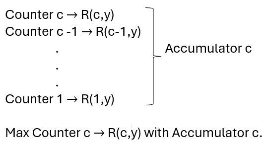
       
      <em>Fig. 1</em>
    </td>
  </tr>
</table>

 

The vertical representation shows the counter in the timeline from the distant past to the present. Here, the Max Counter $n \rightarrow R(c,y)$ has an accumulator $c$, where $1 \le c \le n$, so that we obtain:

<table>
  <tr>
    <td align="center">
      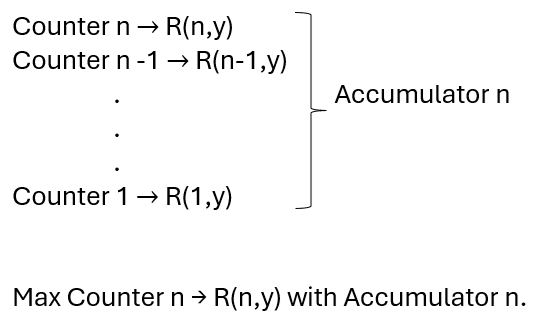
       
      <em>Fig. 2</em>
    </td>
  </tr>
</table>

 

$n$ is the number of discrete jumps that have shaped the universe; for this first part, we will refer to the Planck time as the smallest jump. By discretizing the age of the universe based on $n$, we obtain:

$$n = \frac{\text{Age of the Universe}}{\text{Planck time}} = \frac{138 \times 10^{8}\text{ years}}{10^{-43}\text{ seconds}} = \frac{138 \times 10^{8} \times (31.536 \times 10^{6}\text{ seconds})}{10^{-43}\text{ seconds}} \approx 4.35 \times 10^{60} \quad (4)$$

where $n$ is the number of rows.

$y$ is a counter for the number of rewrites for a $\Delta t = t_{\text{Planck}}$. Thus, $y$ is unique for each $t_{\text{Planck}}$ and represents the maximum number of rewrites for that interval. Now let's consider the case for $y-1$:

<table>
  <tr>
    <td align="center">
      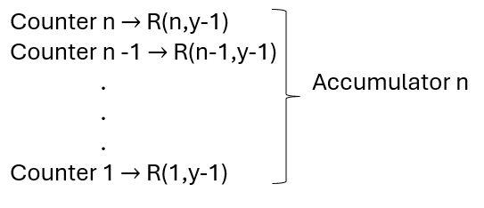
       
      <em>Fig. 3</em>
    </td>
  </tr>
</table>

 

Consider a Max Counter $n \rightarrow R(n,y-1)$ with an Accumulator $n$. In this figure, $(y-1)$ represents the penultimate rewrite, with the present serving as the reference point; thus, $y$ represents the present that is, the current write or the most recent rewrite.

General case of vertical-horizontal time or two-dimensional representation of writing and rewriting:

<table>
  <tr>
    <td align="center">
      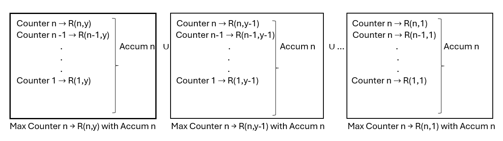
       
      <em>Fig. 4</em>
    </td>
  </tr>
</table>

 

The figure above depicts the entire history of time, written and rewritten since the Big Bang.

In the figures above, we have:

- $R$: Row.
- $\text{Max}$: Maximum.
- $\text{Accum } n$: in general, $\text{Accum } c = \sum_{i=1}^{c} i$ holds, where $1 \le c \le n$; $\text{Accum}$ is the temporal weight that defines the location of each row marking the history of the universe. The ellipsis indicates the continuity of the pattern.

Now, let's examine the history of time by looking at the last four rewrites or the last four temporal weights which include the original writing; we will also examine the structure of each of these temporal weights separately.

<table>
  <tr>
    <td align="center">
      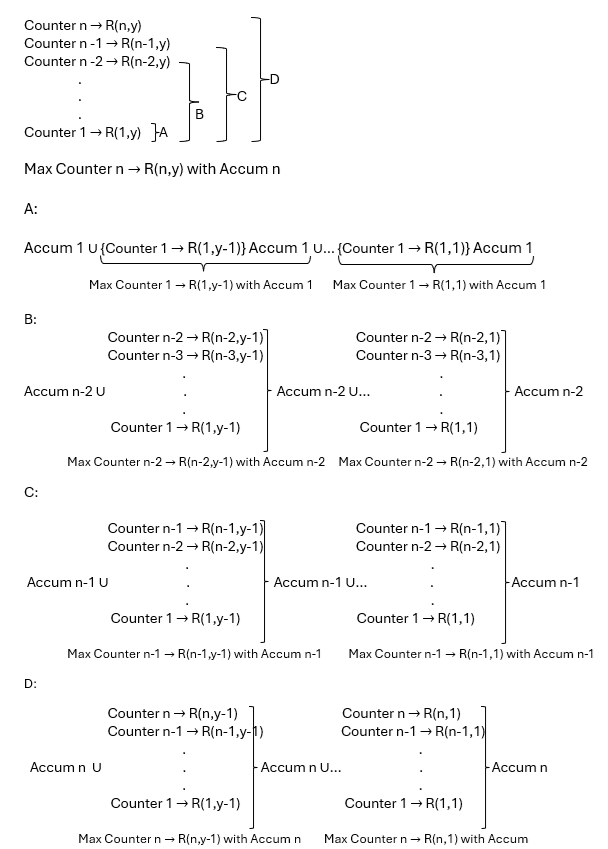
       
      <em>Fig. 5</em>
    </td>
  </tr>
</table>

 

Figure 5 details the storage structure (cause-and-effect records) of the temporal matrix (vertical-horizontal time) from the Big Bang to the present, providing a general representation. Furthermore, the following holds true in Figure 5:

$$C = B + \{\text{Counter } n-1 \rightarrow R(n-1,y)\} \text{ Accum } n-1 \cup \{\text{Counter } n-1 \rightarrow R(n-1,y-1)\} \text{ Accum } n-1 \cup \dots \cup \{\text{Counter } n-1 \rightarrow R(n-1,1)\} \text{ Accum } n-1 \quad (5)$$

$$D = C + \{\text{Counter } n \rightarrow R(n,y)\} \text{ Accum } n \cup \{\text{Counter } n \rightarrow R(n,y-1)\} \text{ Accum } n \cup \dots \cup \{\text{Counter } n \rightarrow R(n,1)\} \text{ Accum } n \quad (6)$$

Figure 5 can be represented in matrix form as follows:

<table>
  <tr>
    <td align="center">
      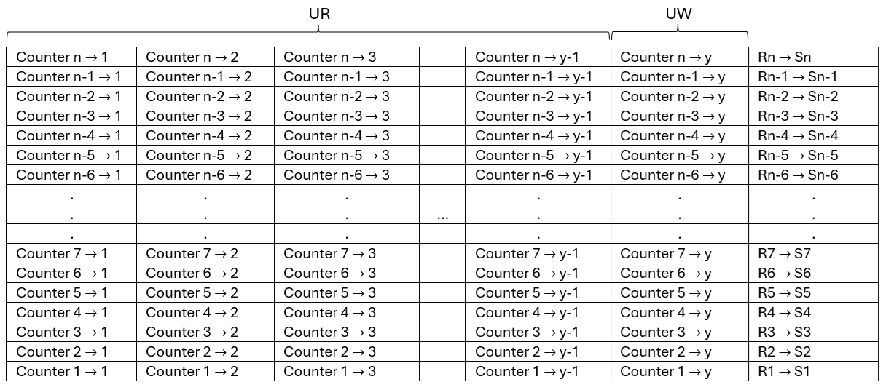
       
      <em>Fig. 6</em>
    </td>
  </tr>
</table>

 

Where:

- $R_c$: Row $c$
- $S_c = \text{Sum } c = \text{Accum } c$; However, in the case of $S_1$, $S_1 = \text{Accum } 1 = \text{Counter } 1$ by default, since by definition $\text{Accum } 1 = \sum_{i=1}^{1} i = 1$
- $UW =$ Universe write.
- $UR =$ Universe rewrite.

The figure above can be abbreviated as follows:

<table>
  <tr>
    <td align="center">
      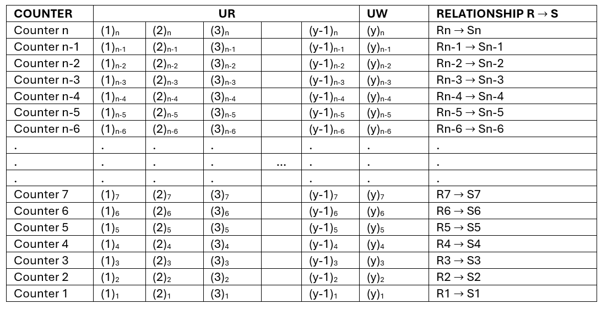
       
      <em>Fig. 7</em>
    </td>
  </tr>
</table>

 

In Figure 7, the counters on the left are optional, since they are implied by the subscripts given in the matrix elements. In the following illustration, we see a simplified representation of Figure 7:

<table>
  <tr>
    <td align="center">
      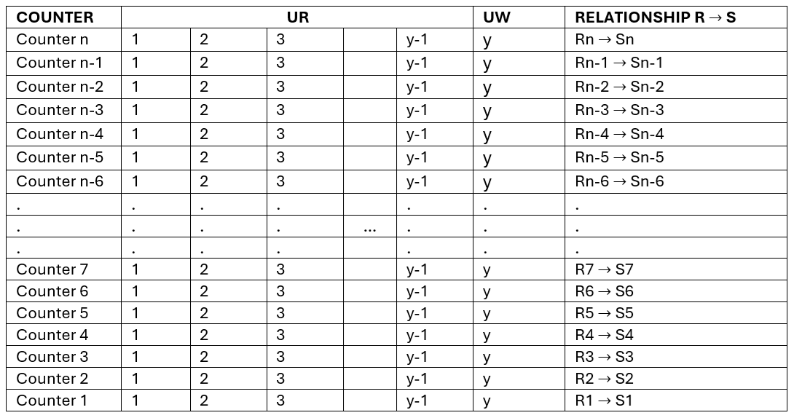
       
      <em>Fig. 8</em>
    </td>
  </tr>
</table>

 

Note in the figures above the one-to-one relationship between the counter and the row, since $\text{Cont } c \rightarrow R_c$.

In the time matrix, the register is filled horizontally for each row, and as $t_{\text{Planck}}$ increases, the total vertical weight grows; that is, the time accumulator increases as the counter increases. Keep in mind that the counter is equal to the increment of the Planck time. Note that in these representations, you can observe the write operation or any rewrite interval. For the sake of clarity, the following illustration is provided:

<table>
  <tr>
    <td align="center">
      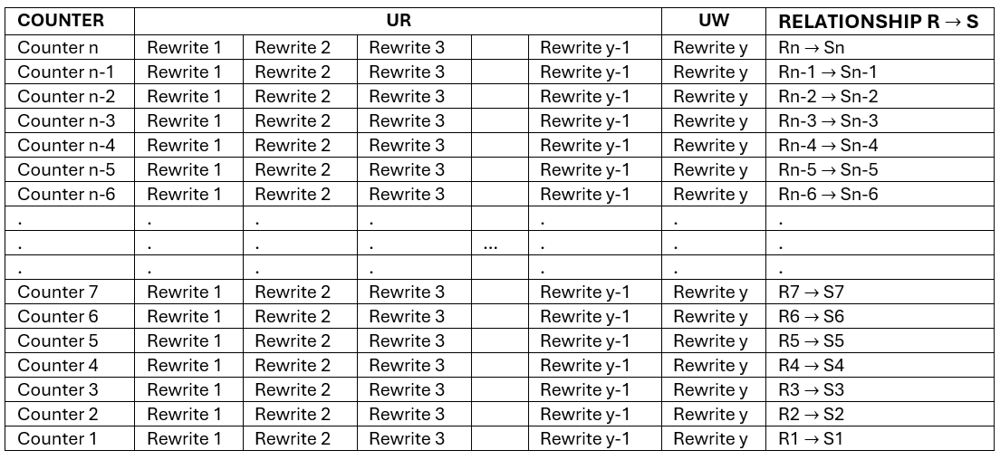
       
      <em>Fig. 9</em>
    </td>
  </tr>
</table>

 

The following holds true in the images below:

- Write $y$ = rewrite $y$ (Last rewrite if and only if the present is being rewritten in those counts)
- Rewrite $y-1$ = Penultimate rewrite
- And so on until:
  - Rewrite $3$ = 3rd rewrite
  - Rewrite $2$ = 2nd rewrite
  - Rewrite $1$ = 1st rewrite

All previous illustrations have described the past and the present; now, the following illustration incorporates the future. Let's take a look:

<table>
  <tr>
    <td align="center">
      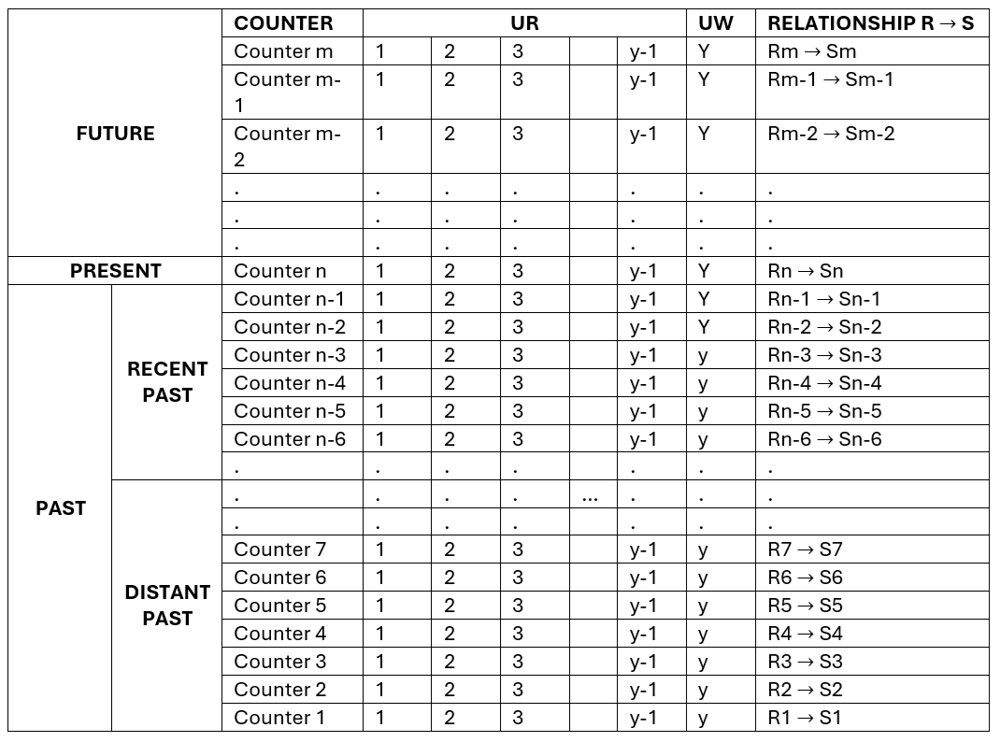
       
      <em>Fig. 10</em>
    </td>
  </tr>
</table>

 

Figure 10 shows that the subscript $m$ will be used for the future, while the subscript $n$ will be used for the present and past; likewise, the recent past allows for rewriting, while the distant past does not this will be analyzed in later chapters.

In the TTM, as a new rewrite occurs, all entries in the same row shift one position to the left, so that the most recent rewrite or write (current write or current rewrite) is placed in the $y$ column of that row.

The nature of the temporal matrix defines it as timeless; this is why it is referred to as the temporal-timeless matrix (TTM).

The TTM has five distinguishable characteristics:

- **Nature of IT:** The TTM is, by definition, both temporal and timeless. The timeless nature contains the temporal nature within itself.
- **EC Storage:** The TTM is a structure for recording information about space ($E$) and fields ($C$) that manifest in our universe. This characteristic is made possible by the very nature of the EC pair, since they record information through the TTM as if they were doing so within themselves from a condensed perspective much like layers of an onion with a number of these "layers" encompassing the history of the universe for each space-field structure that defines the information within existence.
- **C-Dynamism:** The interaction of space and fields (including inert and non-inert matter) defines coherence and decoherence in the universe, which is recorded in the TTM according to the dialectic of information.
- **Information Flow:** The TTM allows for the exchange of information along past-present-future and future-present-past lines, subject to the constraints of the TTM.
- **Universality of Delocalization:** The nature of existence that gives rise to the TTM through the delocalization of information. This topic will be analyzed in later chapters.

### 3.2 Analysis of the rewriting in the TTM

The previous figures were introductory mathematical representations designed to help understand the structure of time; now, we will present more compact matrix representations.

The following illustrations show a sequence of states in which you can observe how the columns of the rewrite are created, with the heights of these columns being proportional to the $\Delta t$ step size for the rewrite. These rewriting jumps are a consequence of the timeless nature inherent in TTM.

Let's look at the sequence of four states for any $\Delta t$ jump, with the following sequence of states holding true for any rewriting.

For state 0:

<table>
  <tr>
    <td align="center">
      <ins>State 0</ins>
       
      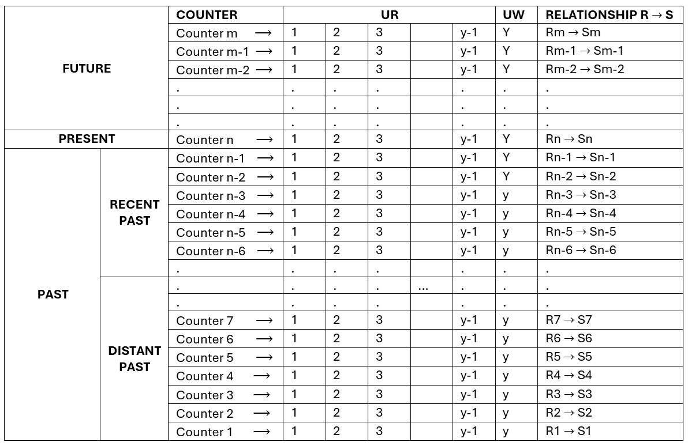
       
      <em>Fig. 11</em>
    </td>
  </tr>
</table>

 

Fig. 11 shows the initial state prior to the $\Delta t$ jump that initiates the rewrite sequence. The representation shown in Figure 10 has been used for this purpose.

For state 1:

<table>
  <tr>
    <td align="center">
      <ins>State 1</ins>
       
      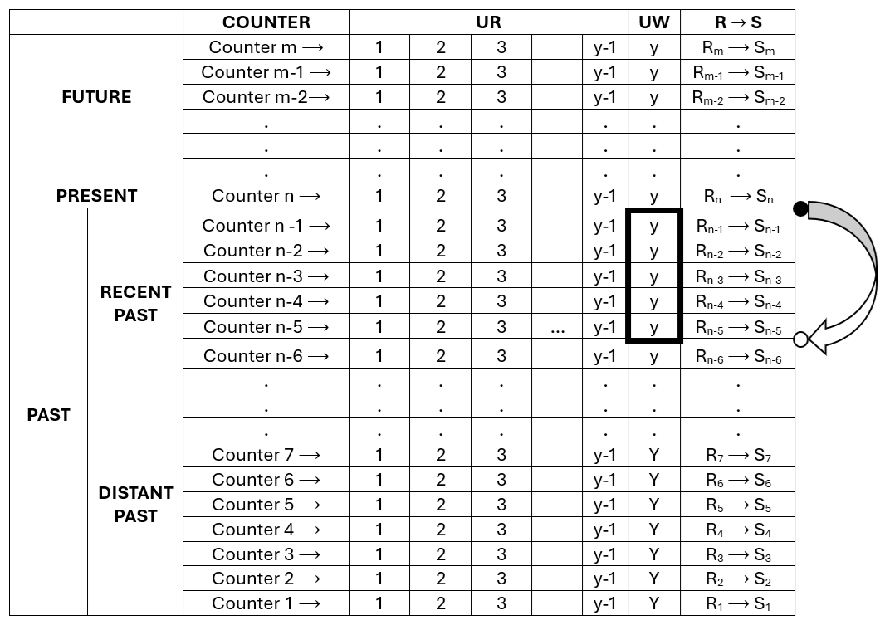
       
      <em>Fig. 12</em>
    </td>
  </tr>
</table>

 

Fig. 12 shows the jump time $\Delta t (\Delta t_S)$, which for this example is $\Delta t_S = 5 t_{\text{Planck}}$. The black (closed) point is the starting point and indicates that it remains closed until the rewrite of $5 t_{\text{Planck}}$ reaches it; meanwhile, the white (open) point is the arrival point and indicates that this point remains open because it is immediately rewritten during the first $\Delta t = t_{\text{Planck}}$. The black box shows the region to be rewritten; it is always rewritten up to the present, and logically, the rewriting carries over into the future.

For state 2:

<table>
  <tr>
    <td align="center">
      <ins>State 2</ins>
       
      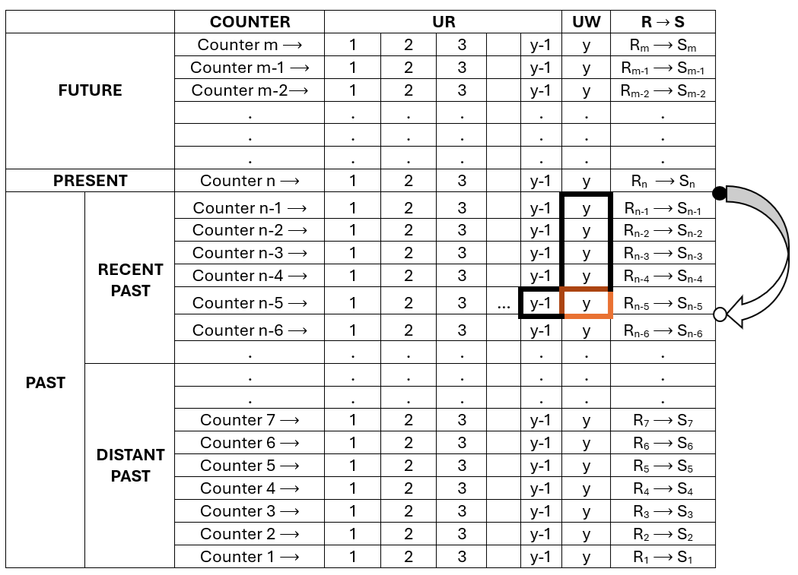
       
      <em>Fig. 13</em>
    </td>
  </tr>
</table>

 

Fig. 13 shows the passage of a $\Delta t = t_{\text{Planck}}$, such that a single $\Delta t = t_{\text{Planck}}$ has been rewritten, as indicated by the orange box, where the previous entry now appears in the black $y-1$ register; In this row, all rewrites have been shifted one register or cell to the left; likewise, it can be seen that there are still four $t_{\text{Planck}}$ left to rewrite to reach the present, as shown in Fig. 13. It should be noted that the darker orange color indicates that this edge or boundary is common to both registers; therefore, it is shown in this color to indicate that the boundaries overlap into a single one.

For state 3:

<table>
  <tr>
    <td align="center">
      <ins>State 3</ins>
       
      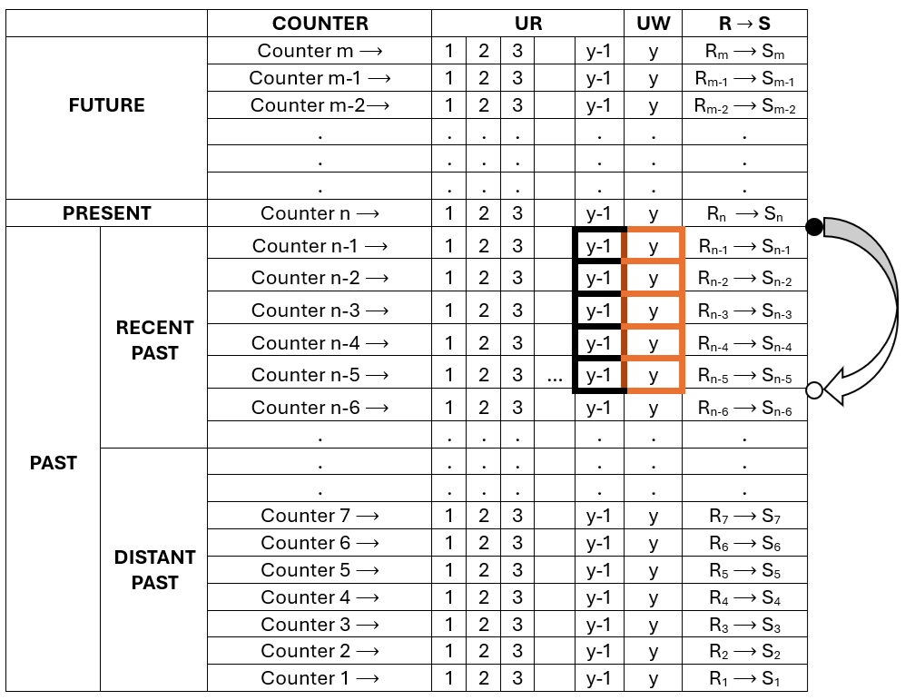
       
      <em>Fig. 14</em>
    </td>
  </tr>
</table>

 

Fig. 13 shows how the rewrite column begins to be constructed; now, in Fig. 14, the complete construction of the rewrite column for $\Delta t_S$ is shown, where its construction has been progressive for each $t_{\text{Planck}}$ such that each new rewritten cell is produced for one $t_{\text{Planck}}$. In the figure above, it can be seen that the black rectangles contain the $y-1$ state of the penultimate write, which for State 0 or State 1 represented the write information for these intervals; but now, after the rewrite, the orange rectangles define the update to the current state or the latest rewrite for $\Delta t_S$, shifting the previous $y$ values to the subsequent $y-1$ values.

Note that in the representations shown, each cell reflects the complete state of the universe for a $\Delta t = t_{\text{Planck}}$ however, the TTM can be segmented for a specific target group within the universe, for example:

- A specific region.
- Number of field and/or space particles, since there are actually two TTM that interact with each other one for space and one for fields. These two TTM will be analyzed in later chapters.
- A single field or space particle.

Now let's look at several specific cases of rewriting, with the aim of gaining a clearer understanding of the nature of the TTM. To do this, I will consider only states 2 and 3 of the different cases, since the evolution of the phenomenon is shown only in these two states through the construction of the rewriting columns; however, it should be noted that between states 2 and 3-which mark the beginning and end of the construction of the rewriting columns-there are always (# remaining states $\Delta t_S - 2$), where "2" refers to states 2 and 3. To maintain a sequence from Fig. 11 through Fig. 14, we would have Case 1 (the Present-Recent_Past or P-RP case of a rewrite signal). For the following cases, the illustration will be simplified, showing only the necessary parts of UR and UW; furthermore, I will use only the future, present, and recent past, since the distant past remains unchanged for all cases; however, I will use a single illustration for all cases, even though I could use more restricted illustrations, since for cases where the future does not interact, I could omit it (the future) from the illustration; likewise, in cases where the recent past does not interact, I could omit it (the recent past) from the illustration. A single restricted illustration will be used (this being the general case of a restricted illustration) with the intention of showing all the cells (part of the matrix) where all possible rewriting cases occur; on the other hand, it should be noted that the illustrations for Case 1 represent the complete (unrestricted) illustration, and it should also be noted that all illustrations from Fig. 11 through Fig. 14 are based on Fig. 10, which I have chosen as the illustration model due to its compact presentation of information and ease of illustration; however, for the following cases, I will make an adjustment to simplify it further, using Fig. 8 as a starting point.

Case 2 (P-RP case with two simultaneous signals at the starting point and the finishing point):

<table>
  <tr>
    <td align="center">
      <ins>State 2</ins>
       
      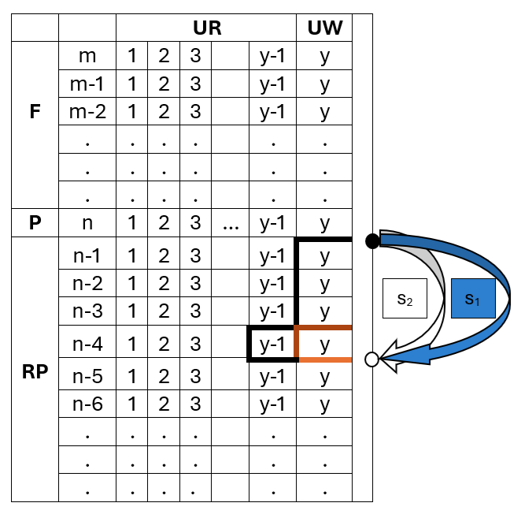
       
      <em>Fig. 15</em>
    </td>
  </tr>
</table>

 

Fig. 15 shows the simplified illustration, in which we can see $F = \text{Future}$, $P = \text{Present}$, and $RP = \text{Recent Past}$, such that $P\text{–}RP$ indicates the direction of the signal relative to the Future-Present-Past time arrow. As can be seen in the simplified illustration, Counter $c$, as well as $R_c$ and $S_c$, have been replaced by a counter ranging from $m$ to $1$, such that counter $\rightarrow (\text{Counter } c, R_c, S_c)$ -that is, it refers to other parameters. Likewise, an extra line has been used to illustrate the jumps in $\Delta t_S$, with $(\Delta t_{S1} = \Delta t_{S2})$. In the figure above, we can see that the two signals interact in the recent past and yield a single rewriting, just as in Case 1.

Before continuing with state 3 of Case 2, let's examine the following two hypotheses that apply to these cases where rewrites occur:

Interaction Hypothesis for a Specific Target Group Within the Universe:

The interaction hypothesis has two cases; let's examine them:

- **Interaction Hypothesis for Inert Matter** (Conscious and unconscious entities existing in the universe do not intervene):
  The signals may or may not be independent of one another; if they are independent, they would be signals such that, when interacting in the RP, the resulting rewrite solution would satisfy the permissible rewrite information (PRI) of the signals at the point of arrival that is, at the signal's receiving $t_{\text{Planck}}$ but if the signals are not independent, they would still satisfy the permissible rewriting information (PRI) at the point of arrival. Any resulting PRI satisfies both the previous $t_{\text{Planck}}$ and the next $t_{\text{Planck}}$ so that for several signals, the following holds:

$$SR = PRI(S_1 + S_2 + \dots + S_k) \quad (7)$$

  Where $S_1$ is Signal 1, $S_2$ is Signal 2, $S_k$ is signal k, and $SR$ is the resulting rewritten signal. In addition:

$$SR = \bigl(PRI(PRI(S_1) + PRI(S_2) + \dots + PRI(S_k))\bigr) \quad (8)$$

$$SR \neq \bigl(PRI(S_1) + PRI(S_2) + \dots + PRI(S_k)\bigr) \quad (9)$$

$$SR = PRI(S_1 + S_2 + \dots + S_k) = \bigl(PRI(PRI(S_1) + PRI(S_2) + \dots + PRI(S_k))\bigr) \quad (10)$$

  This is because the signals $PRI(S_1), PRI(S_2), \dots, PRI(S_k)$ may or may not share common characteristics that affect the resulting $SR$, therefore, an PRI is always required for all interacting signals so that the common and non-common characteristics that prevent rewriting are dispersed by the action threshold established at the point of arrival, where rewriting is only possible if the action decreases below the action threshold established at the point of arrival (arrival $t_{\text{Planck}}$).

  Keep in mind that any of the PRIs may or may not be zero, including the resulting PRI, since signal information that does not satisfy the PRI simply does not manifest itself; this is because it contributes to the action required to exceed the current action threshold, so all possibilities are checked, and the result is the one with the least action. Likewise, any rewrite via the resulting PRI preserves the cause-and-effect relationship in each $t_{\text{Planck}}$ of the record, allowing for continuity of information between the previous $t_{\text{Planck}}$ and the next $t_{\text{Planck}}$.

  For inert matter to validate new records, the following condition must be met:

$$(\text{Resulting action for rewriting}) < (\text{Threshold action for writing}) \quad (11)$$

  Note that "writing" always refers to the "current writing." We will refer to this condition as the condition of inert matter.

- **Interaction Hypothesis for Non-Inert Matter** (involving the consciousnesses and unconsciousnesses that exist in the universe):
  The interventions of consciousnesses and unconsciousnesses in the rewriting for specific groups that is, for a given volume of spacetime depend on the acceptance of the rewriting by each of the interacting consciousnesses and unconsciousnesses within the specific target group. The definition of consciousness-unconsciousness for this study refers to any reorganization of matter that may or may not violate the condition of inert matter, depending on its interaction.

  This hypothesis and therefore these cases apply only to the rewriting process, in which the initial writing may involve actions that can set any threshold value, but seeks the minimum possible action based on the physical conditions of the spacetime environment itself.

**Nonlocality Hypothesis:** Communication is nonlocal in nature. It should be noted that signals travel from the starting point to the end point outside of local spacetime (three spatial dimensions plus time) through hyperspace to record information in the TTM. This hypothesis will be addressed in later chapters.

In general, the following holds true:

$$SR = PRI(S_1 + S_2 + \dots + S_{k_1} + ARIU) \quad (12)$$

where:

$$ARIU = (\text{All remaining information in the universe}) = S_{k_1+1} + S_{k_1+2} + \dots + S_{k_1+k_2} \quad (13)$$

The subscript $k$ belongs to the set of natural numbers ($k \in \mathbb{N}$). The ARIU is all the information that is being rewritten for that specific $t_{\text{Planck}}$.

$SR$ holds for $\Delta t = t_{\text{Planck}}$, and this must occur for every $t_{\text{Planck}}$, where the signals manifest in the information-energy ($L_1$) and information-energy-mass ($L_2$) lines that form bosons and fermions, respectively, and where both local and non-local information exists; $SR$ satisfies the information content of all interacting signals. However, each $S_k$ of the ARIU acts on a specific target group (STG) that requests it, thus permeating the entire universe with rewriting signals that satisfy each of these STGs; furthermore, even if there are multiple signals for the same group, an $SR$ is generated that satisfies that STG.

The following holds true generally for the entire universe:

$$SR = PRI\!\left(\left[\sum_{T=1}^{n_1} \sum_{i=1}^{n_2} \text{Entity Information}_{Ti}\right]\right) = PRI\!\left(\left[\sum_{T=1}^{n_1} ST\right]\right) = PRI\!\left(\text{Matrix}[\text{Entity Information}]_{n_1 \times n_2}\right) = PRI\!\left(\text{Row}[\text{Signals}]_{n_1 \times 1}\right) \quad (14)$$

In addition, there is also the following:

$$S_1 = \sum_{i=1}^{m_1} \text{Entity Information}_{1i} = \text{Entity Information}_{11} + \text{Entity Information}_{12} + \dots + \text{Entity Information}_{1m_1} = \text{Row 1 in the } SR \quad (15)$$

$$S_2 = \sum_{i=1}^{m_2} \text{Entity Information}_{2i} = \text{Entity Information}_{21} + \text{Entity Information}_{22} + \dots + \text{Entity Information}_{2m_2} = \text{Row 2 in the } SR \quad (16)$$

Where:

$$(n_2 \ge m_1) \wedge (n_2 \ge m_2) \wedge \dots \wedge (n_2 \ge m_{n_2}) \quad (17)$$

$$SR = PRI(S_1 + S_2 + ARIU) = PRI\!\left(\left[\sum_{T=1}^{n_1} ST\right]\right) = PRI\!\left(\left(\sum_{i=1}^{m_1} \text{Entity Information}_{1i}\right) \dots \left(\sum_{i=1}^{m_k} \text{Entity Information}_{ki}\right)\right) \quad (18)$$

Entities will be described in another chapter, but they constitute the fundamental description of wave-particles; thus, signals are a set of entities or field excitations. For the universal case at a $t_{\text{Planck}}$, the following holds: $(m_1 + m_2 + \dots + m_k) =$ (All entities of all rewriting signals in the universe at a $t_{\text{Planck}}$). I will call this condition the "partially sufficient condition," since it increases for every $\Delta t_S$ that affects the target $t_{\text{Planck}}$.

With regard to Case 1 (the Present-Recent_Past or P-RP case of a rewriting signal), we would have: $SR = PRI(S_1)$ however, if we could incorporate the rest of the signals in the universe, we could express Case 1 as follows: $SR = PRI(S_1 + ARIU)$; clearly, all previous definitions would be satisfied in this formula.

Simultaneous rewrite signals can only originate from the same $t_{\text{Planck}}$ that is, from the present time so only the case shown in Fig. 15 is permitted. Now, let's examine the following scenarios in Fig. 16, Fig. 17, Fig. 18, and Fig. 19, which are not permitted to occur simultaneously.

Scenario 1:

<table>
  <tr>
    <td align="center">
      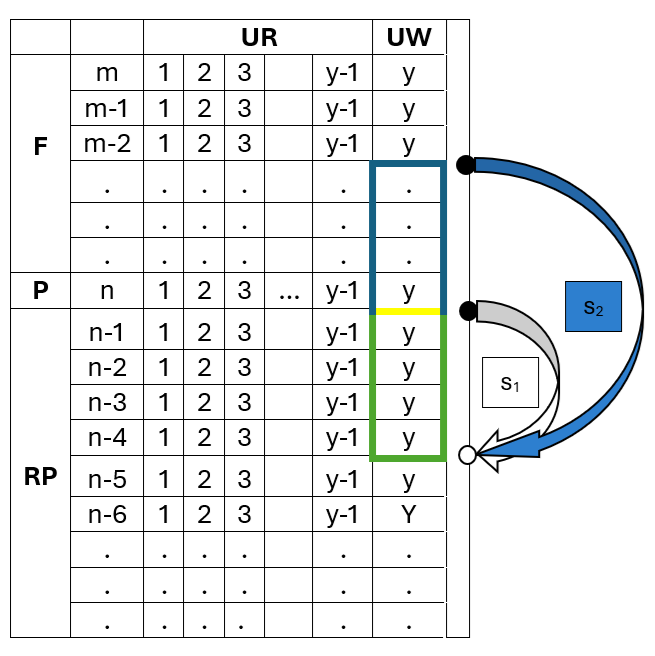
       
      <em>Fig. 16</em>
    </td>
  </tr>
</table>

 

This scenario is not possible simultaneously, since they actually represent different rewrites: first, the $PRI(S_1)$ rewrite is performed, given that its start (signal origin) lies earlier on the TTM vertical line, and then the $PRI(S_2)$ rewrite is performed, so these two rewrites do not overlap.

- **The green color:** Refers to the $\Delta t$ of the double rewrite, where the $PRI(S_1)$ rewrite is performed first, followed by the $PRI(S_2)$ rewrite; at the moment of this rewrite at $y$, the previous $PRI(S_1)$ rewrite moves to $y-1$.
- **The blue color:** Refers to the other part of the $PRI(S_2)$ rewrite, where the following holds for the $PRI(S_2)$ that: $[(\Delta t_1 = \text{green } \Delta t) \cup (\Delta t_2 = \text{blue } \Delta t)]$ defines the entire $\Delta t$ of the $PRI(S_2)$ rewrite, such that $(\Delta t = \Delta t_1 + \Delta t_2)$.
- **The yellow color:** Indicates the end of the $PRI(S_1)$ rewrite, which is logically the original $t_{\text{Planck}}$ of $S_1$.

Scenario 2:

<table>
  <tr>
    <td align="center">
      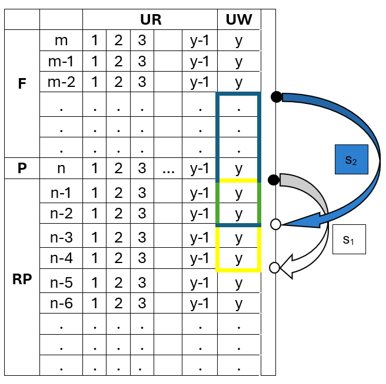
       
      <em>Fig. 17</em>
    </td>
  </tr>
</table>

 

This scenario is also not possible simultaneously, since the two signals represent different rewrites: the $PRI(S_1)$ rewrite would occur first, given that its start (the signal's origin) is located first on the TTMs vertical line, followed by the $PRI(S_2)$ rewrite, so that they do not overlap.

- **Yellow:** Refers to the rewrite performed only by $PRI(S_1)$.
- **Blue:** Refers to the rewrite performed only by $PRI(S_2)$.
- **Green:** Refers to $t_{\text{Planck}}$ instances with double rewriting, where the $PRI(S_1)$ rewrite is performed first, followed by the $PRI(S_2)$ rewrite, as explained for the case in Fig. 16.

Scenario 3:

<table>
  <tr>
    <td align="center">
      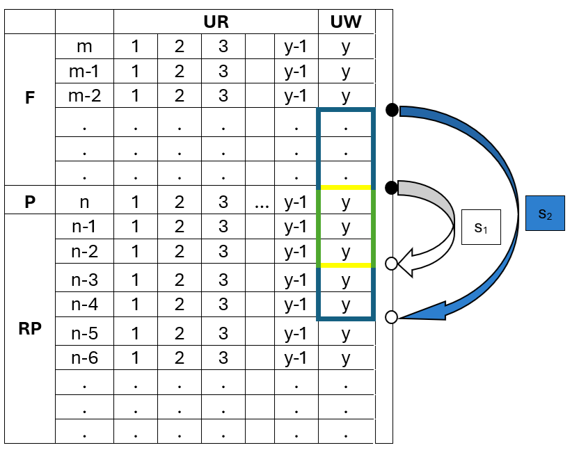
       
      <em>Fig. 18</em>
    </td>
  </tr>
</table>

 

This scenario, like the previous two, also does not allow for simultaneity, since the two signals represent different rewrites. First, the rewrite of $PRI(S_1)$ would occur, given that its start point is earlier on the TTMs vertical line, and then the rewrite of $PRI(S_2)$ would occur, since its start point is later on the TTM, so that they do not coincide with each other.

- **Blue:** Refers to the rewrite performed only by $PRI(S_2)$; these are the time intervals ($t_{\text{Planck}}$'s) during which signal $S_1$ does not intervene for a possible rewrite.
- **Yellow:** Refers to the start and end of the rewrite performed only by $PRI(S_1)$.
- **Green:** Refers to the time intervals during which both signals perform rewrites sequentially, with $PRI(S_1)$ performing the rewrite first, followed by $PRI(S_2)$. It is worth noting that this is the interval during which $PRI(S_1)$ is rewritten.

Scenario 4:

<table>
  <tr>
    <td align="center">
      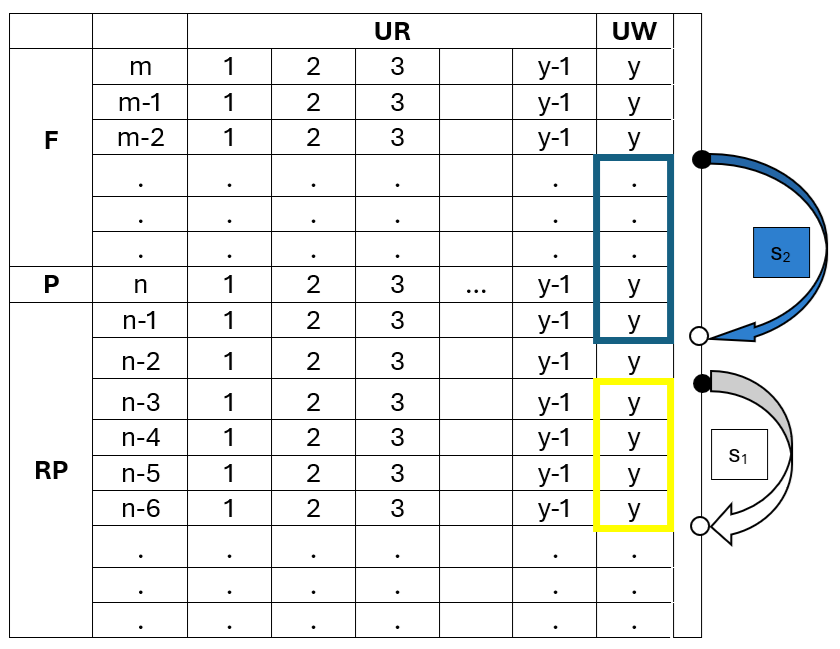
       
      <em>Fig. 19</em>
    </td>
  </tr>
</table>

 

Like the three previous scenarios, this one also does not allow for simultaneity, since the two signals represent different sequential rewrites within the same write operation for different $\Delta t$ values; the $PRI(S_1)$ rewrite is performed first, followed by the $PRI(S_2)$ rewrite.

- **Blue:** Refers to the rewrite performed only by $PRI(S_2)$, as shown in Fig. 19.
- **Yellow:** Refers to the rewrite performed only by $PRI(S_1)$ as shown in Fig. 19.

The last five figures (Fig. 15, Fig. 16, Fig. 17, Fig. 18, Fig. 19) illustrate the origin condition.

**Total origin condition:** For the PRIs of various signals to fully participate in the same rewrite simultaneously, they must start from the same $t_{\text{Planck}}$ of the universe's writing ($UW$) and arrive at the same $t_{\text{Planck}}$ of the universe's writing ($UW$), as shown in Fig. 15.

Now let's look at State 3 of Case 2:

<table>
  <tr>
    <td align="center">
      <ins>State 3</ins>
       
      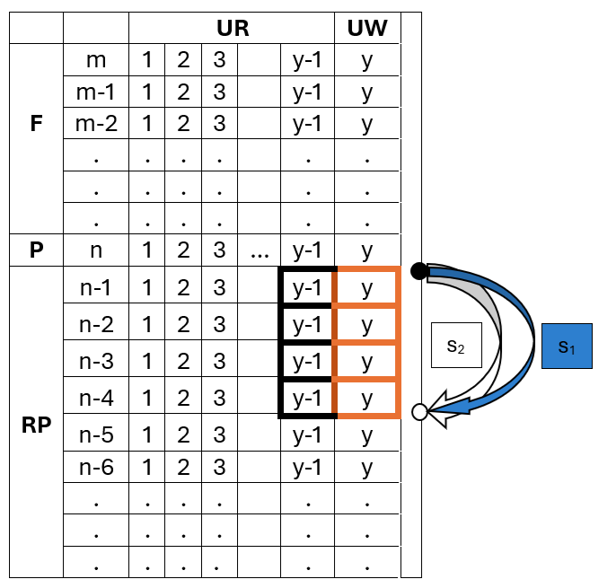
       
      <em>Fig. 20</em>
    </td>
  </tr>
</table>

 

As can be seen in Fig. 20, the process in State 2 has been repeated 3 more times, for a total of 4, since $\Delta t_S = 4 t_{\text{Planck}}$. Thus, Case 1 and Case 2 have a similar transition sequence, except that $\Delta t_S$ is different for each of these cases (Cases 1 and 2). On the other hand, in the illustration, $S_1$ and $S_2$ can be interchanged without affecting the analysis, since the signals are simultaneous they coincide at both the starting point and the endpoint. State 3 in Case 2 satisfies both the Interaction Hypothesis for a specific target group within the universe and the total origin condition.

Case 3 (P-RP case of two signals that coincide only at the start): This case partially satisfies the total origin condition, and the partial origin condition is defined for this specific case.

**Partial origin condition:** For the PRIs of multiple signals to partially participate in the same rewrite simultaneously, they must start from the same $t_{\text{Planck}}$ in the universe write ($UW$) and arrive at different $t_{\text{Planck}}$'s in the universe write ($UW$), as shown in Fig. 21.

For this Case 3, three states will be analyzed to more clearly detail the transition sequence of the process, resulting in States 2, 3, and 4. Let's take a look:

<table>
  <tr>
    <td align="center">
      <ins>State 2</ins>
       
      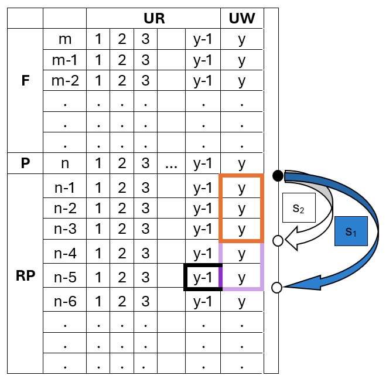
       
      <em>Fig. 21</em>
    </td>
  </tr>
</table>

 

In State 2 of Fig. 21, it can be seen that the signals coincide at the starting point but not at the arrival point; as a result, two sequential rewrites are obtained for different $\Delta t = t_{\text{Planck}}$ note that the term "simultaneous" is used only for signals that coincide at the same $\Delta t = t_{\text{Planck}}$ at their start and at the same $\Delta t = t_{\text{Planck}}$ at their arrival; thus, if two signals satisfy the condition of total origin, they can be called "synchronous" in a temporal sense. On the other hand, if they coincide only at the same $\Delta t = t_{\text{Planck}}$ at their start, that is, they satisfy the partial origin condition and can be called "synchronous" in a non-temporal sense; and if they do not satisfy either of the two conditions, they can be called "asynchronous" in a non-temporal sense.

In the figure above, the rewriting begins at the $IPR(S_1)$ in the incoming $t_{\text{Planck}}$ corresponding to row $n-5$ The figure shows the first rewriting for that row, where the following holds:

- **Light purple:** Refers to the rewriting performed only by the $IPR(S_1)$.
- **Black:** Refers to the previous write that has been moved to record $y-1$ of row $n-5$.
- **Dark purple:** Refers to the common boundary between the current write by $IPR(S_1)$ and the penultimate rewrite belonging to the same row that is, the common boundary between $y$ and $y-1$ of $n-5$.
- **Light orange:** Refers to the rewrite involving $IPR(S_1)$ and $IPR(S_2)$, where $IPR(S_2)$ waits on row $n-3$ for the arrival of the rewrite initiated by $IPR(S_1)$.

Note that each resulting PRI for an arrival $t_{\text{Planck}}$ initiates a rewrite for each subsequent rewrite $t_{\text{Planck}}$ however, this PRI resulting from one or more interacting signals that begins at a given $t_{\text{Planck}}$ only initiates the rewrite, with the interaction hypothesis for the specific target group of the previous $t_{\text{Planck}}$'s rewrite being reevaluated at each subsequent $t_{\text{Planck}}$.

<table>
  <tr>
    <td align="center">
      <ins>State 3</ins>
       
      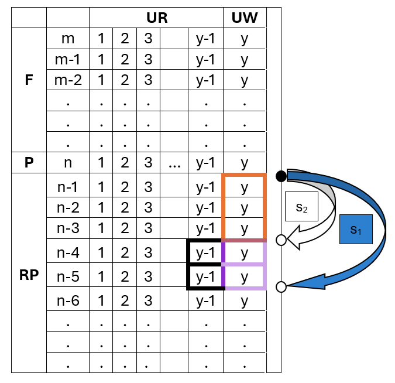
       
      <em>Fig. 22</em>
    </td>
  </tr>
</table>

 

Fig. 22 shows only the complete transitions of the $PRI(S_1)$, where $\Delta t = 2 t_{\text{Planck}}$ when the $PRI(S_1)$ reaches $(n-3)$, the interaction hypothesis arises as a consequence of the rewriting of the previous $t_{\text{Planck}}$, which stems from the rewriting initiated by the $PRI(S_1)$ and by the $PRI(S_2)$ of signal $S_2$, thereby fulfilling the condition of partial origin between these PRIs, which manifests in the resulting PRI; thus, these signals $S_1$ and $S_2$ are "timelessly synchronous."

It should be noted that the number of records per row varies, so that $y \in n$ may or may not be equal to $y \in n-4$ -a condition that holds for all rows meaning that an $y$ in a given row may or may not coincide with the number of records for another $y$ belonging to a different row. In the illustration, each $y$ can represent a different number, so that for any given case, the records "1," "2," and "3," etc., shown in the different columns of the illustration do not necessarily appear in the same column, since the number of rewrites per $t_{\text{Planck}}$ may or may not match that of another row.

<table>
  <tr>
    <td align="center">
      <ins>State 4</ins>
       
      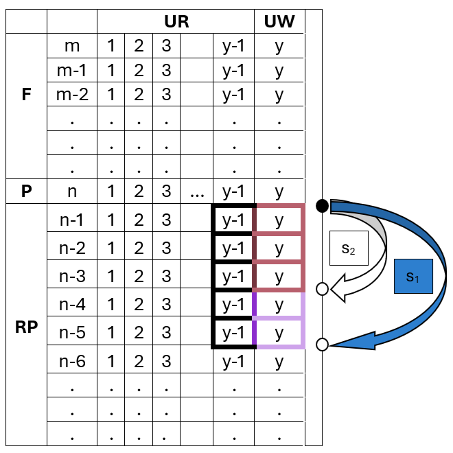
       
      <em>Fig. 23</em>
    </td>
  </tr>
</table>

 

Fig. 23 shows the complete transition of the $IPR(S_1)$ and $IPR(S_2)$ rewrites. The illustration is self-explanatory; it is essentially the same explanation as for the previous state, but for a $\Delta t = 5 t_{\text{Planck}}$ However, note that a new column is created for each new rewrite signal, and the number of rewritten columns increases for the $t_{\text{Planck}}$ rewritten as the number of different allowed rewrite calls increases according to the interaction hypothesis, where the resulting rewrite IPR is updated for each $t_{\text{Planck}}$. For this example, we have only one rewrite call for the write column given by the partial origin condition and therefore only one new column added for the total rewritten $\Delta t$. Let's look at the description:

- **Light purple:** Refers to the rewrite performed only by $IPR(S_1)$.
- **Black:** Refers to the previous write that has been shifted to record $y-1$, from row $(n-5)$ through row $(n-1)$.
- **Dark purple:** Refers to the common boundary between the current write by $IPR(S_1)$ and the penultimate rewrite, from line $(n-5)$ through row $(n-1)$ -that is, the common boundary between $y$ and $y-1$ for these rows.
- **Light brown:** Refers to the rewrite involving $IPR(S_1)$ and $IPR(S_2)$ that satisfies the partial origin condition.
- **Dark brown:** Refers to the common boundary between the current writing defined by $IPR(S_1 + S_2)$ and the common boundary between $y$ and $y-1$ from row $(n-3)$ up to and including row $(n-1)$

In the figures above, a record refers to a specific target group (GOE) or to the universe itself, consisting of all records and all GOEs that would satisfy the previously argued conditions and hypotheses, which must be verified according to the laws of physics that define our universe.

In the next chapter, we will conduct an analysis with greater emphasis on the aggregates themselves, where the writings of our universe's spacetime are recorded in the 4th spatial dimension (fourth spatial dimension) for the writing, expand into the 5th spatial dimension for the rewriting (fifth spatial dimension), and the aggregates would lie in the 6th spatial dimension (sixth spatial dimension), in addition to other higher dimensions, where all the information from the different dimensions resides in the TTM. By definition, the temporal-timeless matrix is a hypervolume that records information from all spatial dimensions in a timeless existence where temporal flows of sequences reside.
